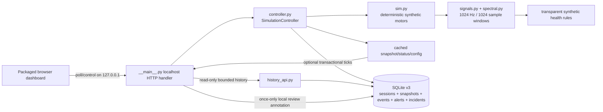
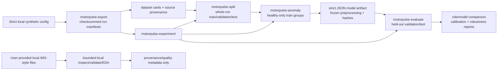

# Architecture — MotorPulse AI

MotorPulse AI is a **local-first synthetic motor monitoring and predictive-maintenance research lab**. It combines a deterministic online simulator/dashboard with an offline reproducible research toolchain. The project is intentionally software-only: **No hardware control**, PLC communication, remote actuation, production alarm handling, or validated field diagnostics are implemented.

The runtime has zero third-party Python dependencies. Build/quality tooling is separate from runtime requirements.

## Architectural boundaries

Three boundaries are intentionally kept separate:

1. **Online synthetic simulation** — an in-process deterministic simulator, controller, optional local SQLite history, localhost JSON API, and packaged browser dashboard.
2. **Offline research pipeline** — deterministic synthetic exports and optional inspection of user-provided local IMS-style files, followed by provenance-aware splitting, model fitting, held-out evaluation and reports.
3. **Third-party/physical world** — no automatic dataset download, no real sensors, no PLCs/actuators, no cloud prerequisite, and no supported public-network deployment.

A model/report produced by the offline pipeline is not loaded into the live dashboard as a physical failure predictor. The live rule health classes remain transparent synthetic demo rules.

## Online simulator, API, persistence and dashboard

The HTTP server is `ThreadingHTTPServer` bound to **127.0.0.1**. Browser polling reads cached snapshots and never advances the simulator. The controller owns the timed worker and synchronization: Start resumes automatic ticks, Pause freezes, Step creates exactly one tick while paused, and Reset deterministically recreates tick 1 from the current seed/clock/configuration.

Virtual acquisition time and wall-clock scheduling are deliberately separate. A vibration window remains 1024 samples at 1024 Hz (one nominal second), while `step_seconds` controls labelled virtual time between ticks and `interval_seconds` controls requested real worker cadence.

### Configuration and runtime state

There are two mutation contracts:

- **Asset configuration**: `GET /api/config` and `PUT /api/config` use one `{ "assets": [...] }` scenario schema. `--config FILE` loads that same schema before the server opens its socket. Scenario/fault/operation rules live in `scenarios.py`, [SCENARIOS.md](SCENARIOS.md), [PROGRESSION.md](PROGRESSION.md), and [OPERATIONS.md](OPERATIONS.md).
- **Runtime seed/clocks**: `PUT /api/runtime` changes the deterministic seed, virtual tick step, and wall worker interval while preserving the asset scenarios and virtual epoch. See [RUNTIME_CONTROLS.md](RUNTIME_CONTROLS.md).

Both runtime mutations validate a candidate before live state changes. When SQLite persistence is enabled, the new initial snapshot/session is committed before the controller publishes the new in-memory state; failures preserve the previous live state.

### Strict localhost API boundary

`motorpulse/__main__.py` exposes live/config/control routes plus the MP-040/MP-042 history/incident routes. Mutation bodies are JSON-only, limited to 16,384 bytes, reject duplicate keys/non-standard constants and cap parsed nesting at 64. Unknown API routes/methods return stable machine-readable error codes. The consolidated contract is [API.md](API.md).

The history adapter in **history_api.py** is read-only with respect to simulation state. It validates a maximum 2048-byte query, exact allowlisted fields, 1–100 row pages, newest-first row-ID cursors, UTC filters, and source/session/asset filters before calling the controller's parameterized SQLite repository methods.

### SQLite v3 persistence

Persistence is opt-in via `--database PATH.sqlite3`. Without it, the live demo stays memory-only.

A successful persisted tick commits the snapshot, per-asset telemetry, raw rule-alert rows, incident reductions/transitions and session linkage transactionally before the controller publishes the tick. Reset, asset-config changes, runtime changes and process restart create distinct session identities so recordings are not silently merged.

SQLite v3 adds deterministic synthetic incident lifecycle state on top of existing history. Incidents are derived from stored synthetic rule evidence; reviewer acknowledgements are once-only local annotations and are not authenticated identities or maintenance approvals. See [SQLITE_HISTORY.md](SQLITE_HISTORY.md), [HISTORY_API.md](HISTORY_API.md), and [ALERT_LIFECYCLE.md](ALERT_LIFECYCLE.md).

## Offline synthetic research pipeline

Synthetic export replays the simulator independently of the HTTP server and writes bounded CSV/JSONL events plus a checksummed manifest. It never reads live dashboard state or SQLite history.

The core research pipeline is leakage-aware:

- source runs are checksummed and provenance-bound;
- **whole-run** grouping keeps complete source runs together across train/validation/test;
- the baseline is **healthy-only** and fits scaling/thresholds from verified training groups only;
- feature-processing parameters and source/split identities are frozen into strict non-executable JSON artifacts;
- validation/test scoring is **held-out** and verifies model/source/split provenance before computing metrics;
- rules and the trained baseline are compared on the same eligible synthetic windows;
- sensor-bad windows abstain rather than becoming fabricated zero-valued evidence.

See [DATASET.md](DATASET.md), [SPLITS.md](SPLITS.md), [ANOMALY_BASELINE.md](ANOMALY_BASELINE.md), [FEATURE_PIPELINE.md](FEATURE_PIPELINE.md), [MODEL_ARTIFACTS.md](MODEL_ARTIFACTS.md), [EVALUATION.md](EVALUATION.md), and [EXPERIMENTS.md](EXPERIMENTS.md).

## IMS/local third-party-data boundary

IMS support is deliberately offline and user-side. `motorpulse-ims` and related commands inspect/validate **already-obtained local files**; the application does not download the NASA IMS archive or expose it through the live API. Synthetic 1024 Hz assumptions, units, labels, bearing mapping, timezone, failure onset, or RUL are never silently assigned to IMS data.

Project documentation may preserve source citations/metadata, but raw or derived third-party waveform redistribution remains prohibited until a documented rights review establishes permission. See [DATA_PROVENANCE.md](DATA_PROVENANCE.md), [IMS_INGESTION.md](IMS_INGESTION.md), and [IMS_VALIDATION.md](IMS_VALIDATION.md).

## Main modules

| Area | Modules / assets | Responsibility |
| --- | --- | --- |
| HTTP/UI | `motorpulse/__main__.py`, `motorpulse/web/` | localhost API, static dashboard, strict request boundary |
| Controller | `motorpulse/controller.py` | thread-safe worker, atomic control/config/runtime operations |
| Synthetic model | `motorpulse/sim.py`, `signals.py`, `spectral.py`, `scenarios.py` | deterministic windows, features, rules, scenarios |
| Local persistence | `motorpulse/storage.py`, `incidents.py`, `history_api.py` | SQLite v3 transactions, bounded history, incident lifecycle |
| Export/provenance | `export.py`, `dataset_cards.py` | reproducible synthetic files and source identity |
| Research splits/features | `splits.py`, `feature_pipeline.py` | whole-run separation, train-only processing, purge safeguards |
| Model/evaluation | `anomaly.py`, `model_artifact.py`, `evaluation.py` | healthy-only baseline, frozen artifacts, held-out metrics |
| Research reporting | `experiment.py`, `robustness.py`, `comparison.py`, `calibration.py`, `rul_research.py` | reproducible experiments and explicitly bounded analyses |
| Local IMS exploration | `ims.py`, `ims_validation.py`, `eda.py` | bounded user-provided file inspection, never live prediction |

Installed command entry points and a contributor walkthrough are in [CLI.md](CLI.md).

## Failure and atomicity model

- **Reads** (`snapshot`, `status`, `config`, history) do not advance simulation state.
- **Ticks** publish only after their optional SQLite transaction succeeds; worker persistence errors pause automatic advancement.
- **Asset config/runtime changes** construct/validate candidate state first and persist the new session/tick before publication when storage is enabled.
- **Strict local files** reject malformed/oversized/duplicate-key/non-finite JSON before server startup or downstream mutation.
- **Offline outputs** are provenance-bound and generally fail closed rather than silently overwriting or accepting changed sources.

Operational symptoms and recovery guidance are centralized in [TROUBLESHOOTING.md](TROUBLESHOOTING.md).

## Security and deployment boundary

This is not a production API server. It has no authentication, authorization, TLS termination, internet-facing rate limiting, secret management, or remote audit identity. Its safe default is loopback-only development use. Do not port-forward it. Any future public/networked or hardware-facing deployment would require a separate threat model, authentication/authorization, transport security, rate limits, operational audit design, device safety analysis, and explicit project approval.

## Scientific non-goals

- No claim that synthetic faults reproduce a specific physical motor or bearing geometry.
- No validated industrial alarm/severity thresholds.
- No physical failure probability, maintenance recommendation, or RUL prediction from the live API.
- No claim that synthetic held-out metrics transfer to field accuracy.
- No silent conversion of IMS/third-party records into synthetic units/labels.
- No hardware control or work-order automation.
