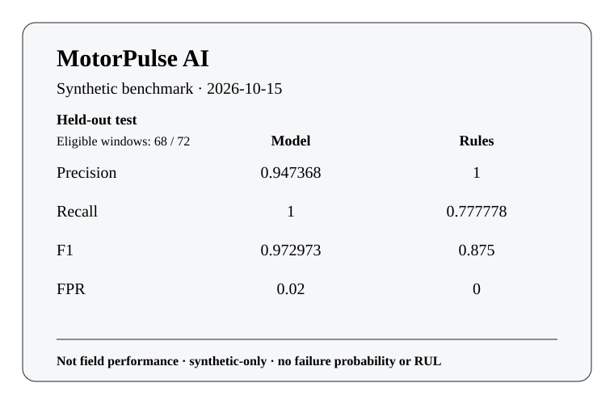

# MotorPulse AI — Dated synthetic benchmark (MP-015)

**Benchmark date:** 2026-10-15

This is a **synthetic-only** reproducibility snapshot. It compares the frozen
healthy-trained anomaly baseline with the existing illustrative rules on
disjoint **whole-run** held-out generator runs. These numbers are **not field performance**.
They are not calibrated failure probability, physical maintenance lead time,
industrial reliability, or Remaining Useful Life (**RUL**) evidence.



## Reproduce

Run the underlying experiment into a new directory:

```bash
python -m motorpulse.experiment \
  --config docs/examples/experiment-v1.json \
  --out-dir /tmp/motorpulse-mp015-experiment
```

Regenerate this report and its repo-local SVG media on Python 3.13:

```bash
python scripts/generate_benchmark_report.py \
  --date 2026-10-15 \
  --config docs/examples/experiment-v1.json \
  --markdown docs/BENCHMARK.md \
  --svg docs/demo/benchmark-summary.svg
```

The generator creates outputs exclusively and refuses to overwrite existing files.
For a byte-for-byte check, generate into new temporary paths; the Python 3.13
regression test does exactly that. Cross-Python floating-point byte identity is
not claimed by the project.

## Fixed benchmark setup

- Config: `docs/examples/experiment-v1.json`
- Generator seeds: `[11, 22, 33, 44, 55]`
- Ticks per run: 24
- Virtual step: 1.5 seconds
- Whole-run split ratios: `[0.6, 0.2, 0.2]`
- Training groups: `synthetic-run:2d61523869e54f40f37c006c, synthetic-run:d80579b9e8aa4812b9a9490a, synthetic-run:f8f6acd62b70067b2ad49f1b`
- Validation groups: `synthetic-run:9c250de52141c5793340579b`
- Test groups: `synthetic-run:974d9f9d1f1ebe74bd72b8d4`
- Model fitting: healthy + sensor-good training windows only; preprocessing and
  the original anomaly threshold stay frozen for validation/test.
- Both model and rules use the same good-sensor held-out denominator; missing
  and injected-outlier windows are abstentions.

## Validation held-out

- Whole-run evaluated groups: `synthetic-run:9c250de52141c5793340579b`
- Eligible good-sensor windows: 68 / 72
- Sensor abstentions: `{"missing": 2, "outlier": 2}`
- Synthetic fault episodes: 1 total; model detected 1, missed 0; mean delay 0 simulated seconds

| Metric | Model | Rules |
| --- | ---: | ---: |
| Eligible windows | 68 | 68 |
| TP | 18 | 14 |
| FP | 0 | 0 |
| TN | 50 | 50 |
| FN | 0 | 4 |
| Precision | 1 | 1 |
| Recall | 1 | 0.777778 |
| F1 | 1 | 0.875 |
| FPR | 0 | 0 |
| PR average precision | 1 | undefined |
| False alarms / simulated negative hour | 0 | 0 |

Evaluation SHA-256: `85d19dcd19017b156849149570ff9723d7d0f143f71669f4d8fb8869336b0281`

## Test held-out

- Whole-run evaluated groups: `synthetic-run:974d9f9d1f1ebe74bd72b8d4`
- Eligible good-sensor windows: 68 / 72
- Sensor abstentions: `{"missing": 2, "outlier": 2}`
- Synthetic fault episodes: 1 total; model detected 1, missed 0; mean delay 0 simulated seconds

| Metric | Model | Rules |
| --- | ---: | ---: |
| Eligible windows | 68 | 68 |
| TP | 18 | 14 |
| FP | 1 | 0 |
| TN | 49 | 50 |
| FN | 0 | 4 |
| Precision | 0.947368 | 1 |
| Recall | 1 | 0.777778 |
| F1 | 0.972973 | 0.875 |
| FPR | 0.02 | 0 |
| PR average precision | 1 | undefined |
| False alarms / simulated negative hour | 48 | 0 |

Evaluation SHA-256: `7e47c4127aacb7f33b91c5a651b945b1fb0882f13ae3ad1985ffb400539e0caf`

## Provenance

- Experiment config SHA-256: `a5f456e4adc331571538080ce17dba178b39268cec742c78b04c5d9eda732ee5`
- Split plan SHA-256: `f3b68ca3d938392d7b7549261b64ec3fdb48da4a45b66654c6969d33fee1708c`
- Trained model SHA-256: `18ef5ceef2351ced6cc54dd084db7355ad8525fe383b11830698bbf4fa3a06b9`
- Portable artifact SHA-256: `c10cfff19ae2c897b111e69595a34347280c107cf6c6d121bc77067b4ceb266f`
- Feature pipeline SHA-256: `4408502f8f62355d401875daa888c8b831bf0af0558a15c38ad8efb78c190920`
- Runtime dependencies recorded by the experiment: none.
- Source data: locally generated MotorPulse synthetic feature events only; no
  IMS archive or third-party derived records are used.

## Interpretation limits

The benchmark is a software/reproducibility demonstration against scripted
simulator truth. Distinct seeds still share the same generator equations and do
not establish independent machine populations. A higher synthetic metric does
not validate diagnosis, alert calibration, domain transfer, maintenance value,
failure probability, or RUL. The SVG is generated from the same test report and
is demo media, not a screenshot of physical equipment or measured telemetry.
